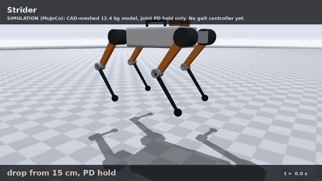
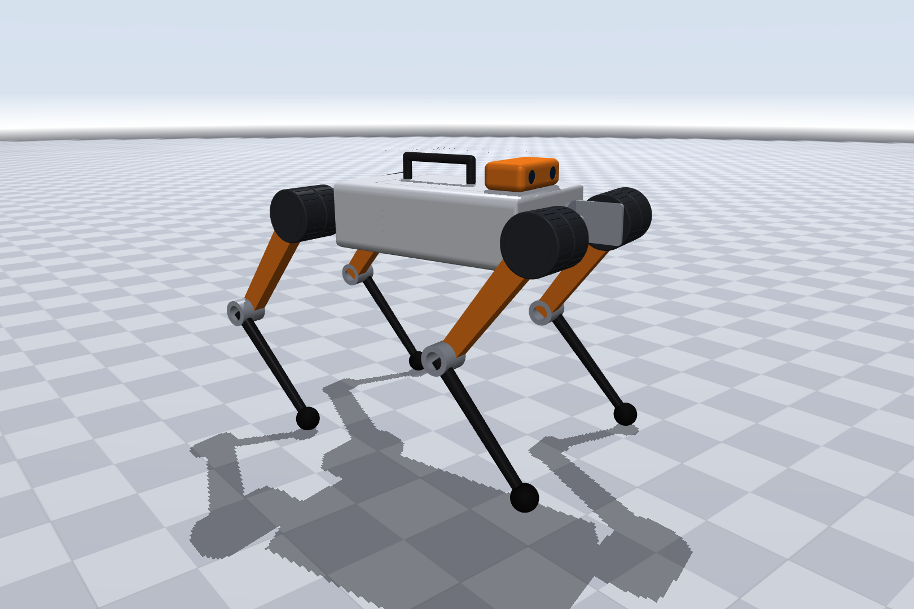

# Strider: a walking robot dog in simulation

Strider is a 12-joint, ~12 kg quadruped designed in code and made to walk in MuJoCo, with a classical
convex-MPC controller and a learned (PPO) policy compared head to head, a sim-to-sim transfer check, and the
int8 policy running bit-exact on the [Vortex-V](https://github.com/Ashtonantony28/vortex-v) RISC-V core.
Full plan: [docs/PLAN.md](docs/PLAN.md).

## Status

| Milestone | Scope | State |
|---|---|---|
| M0 | Scaffold, spec, MJCF generator, Go2 reference, analytic physics tests | done |
| M1 | build123d CAD, mass properties from CAD, geometry audit | CAD + audit done; actuator models next |
| M2-M9 | CPG, EKF, MPC, RL, stairs, sim-to-sim, Vortex-V HIL, replay | planned |

## Demo



*The CAD-meshed 12.4 kg model in MuJoCo. It is dropped from 15 cm, then driven through crouch, stand and paw-raise poses by the joint PD hold from `sim/stand.py`. This is physics **simulation** with spec actuator limits. There is no gait or balance controller yet (M2+), which is why it tips onto three legs when a paw comes up. Regenerate it with `MUJOCO_GL=egl python -m viz.demo_video`. [MP4](docs/media/strider-demo.mp4)*



## Quick start

```bash
pip install -r requirements.txt
python -m model.fetch_reference   # Unitree Go2 from MuJoCo Menagerie, pinned + checksummed
python -m cad.build               # CAD -> meshes, spec/massprops.yaml, build/cad/strider_home.step
python -m model.build             # build/strider.xml from spec/robot.yaml + CAD outputs
python -m cad.audit               # geometry audit -> docs/AUDIT-geometry.md
MUJOCO_GL=egl python -m viz.render --out renders/
pytest -q tests/                  # Verify command
```

## Layout

- `spec/robot.yaml`: every robot parameter (single source of truth)
- `cad/`: parametric CAD of every part (build123d), exact mass properties, geometry audit
- `model/`: spec loader, MJCF generator, Go2 fetcher
- `viz/`: renders
- `sim/`: simulation helpers (M0: joint PD hold used as a smoke test)
- `tests/`: analytic physics references (free fall, exact large-amplitude pendulum period, energy and
  angular-momentum conservation, Coulomb friction) and model tests
- `docs/adr/`: decisions (0001 frames/joint order/units, 0002 MuJoCo + generated model, 0003 CAD-derived
  geometry and mass)
- `docs/AUDIT-geometry.md`: latest geometry audit (overlaps, attachment, mass, collision coverage, sweeps)

The Unitree Go2 model is © Unitree Robotics, BSD-3-Clause, fetched at run time from MuJoCo Menagerie and not
redistributed here.
